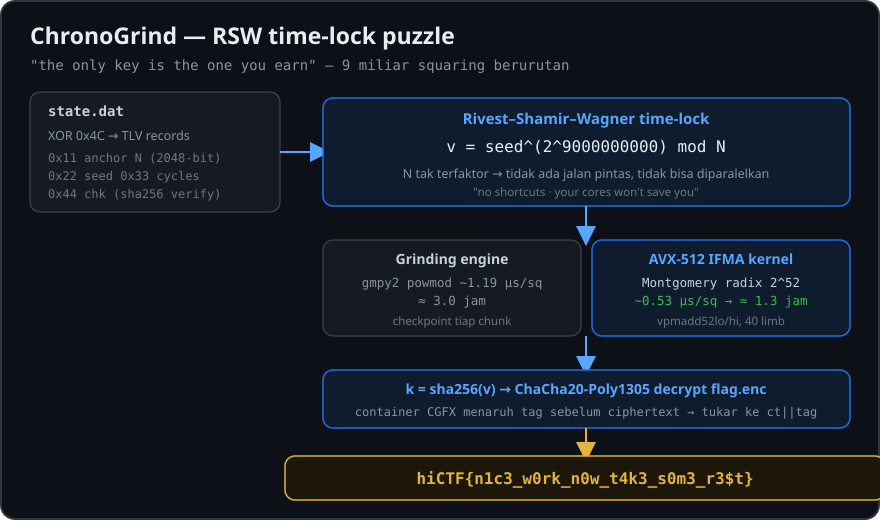

# ChronoGrind — Writeup

| | |
|---|---|
| **Event** | hiCTF (HICON 2026) |
| **Author** | Hidden Investigations |
| **Kategori** | Cryptography |
| **Poin** | 59 pts |
| **Solves** | 312 |
| **Flag** | `hiCTF{n1c3_w0rk_n0w_t4k3_s0m3_r3$t}` |

<p align="center">
  
</p>

## Deskripsi Soal

> Patience isn't a virtue here, it's the only exploit. The wearable sealed the coach's message, and the only key is the one you earn. state.dat is stubborn but honest, it keeps notes on itself. No bugs, no leaks, no shortcuts, and no, your cores won't save you. Bring a charger.
>
> **Files:** `chronogrind.zip`
> **SHA-256:** `5a5316e688fdd9ee3ae30d85a5659a52d0a5c0adf74ac71ba95583467ac256b3`
> **Flag Format:** `hiCTF{}`

Isi arsip:

```
chronogrind/
├── flag.enc    (68 byte)
└── state.dat   (1358 byte)
```

## TL;DR

`state.dat` adalah file TLV yang di-XOR dengan `0x4C`. Di dalamnya ada catatan yang menjelaskan cara membuat kunci, yaitu **time-lock puzzle RSW**:
`v = seed^(2^9.000.000.000) mod N`, `k = sha256(v)`, lalu `flag.enc` didekripsi dengan ChaCha20-Poly1305.
N tidak bisa difaktorkan, jadi satu-satunya cara adalah menghitung 9 miliar squaring modular secara berurutan. Saya mempercepatnya dengan kernel Montgomery AVX-512 IFMA buatan sendiri, sehingga waktunya turun dari ±3 jam menjadi ±1,5 jam.

---

## 1. Recon `state.dat`

Hexdump awal terlihat acak, tetapi byte `0x4C` (`L`) muncul sangat sering. Itu tanda khas data yang di-XOR dengan satu byte, karena byte nol di data aslinya berubah menjadi kunci XOR-nya. Setelah di-XOR dengan `0x4C`, strukturnya langsung terlihat:

```
"CGD1" | ver | ... | [tag (1)] [len (4, little-endian)] [data (len)] ...
```

Header-nya 6 byte, lalu diikuti rangkaian record TLV:

| Tag | Panjang | Isi |
|---|---|---|
| `0x01` | 12 | `team=testrun` |
| `0x11` | 259 | **anchor** N (base241), 2048-bit |
| `0x22` | 259 | **seed** (base241) |
| `0x33` | 10 | **cycles** = `9000000000` |
| `0x44` | 8 | **chk** = `3afdd49ebe78a45a` |
| `0x55` | 32 | `the anchor holds. keep grinding.` |
| `0x66` | 259 | angka 2047-bit tak dikenal (umpan) |
| `0x77` | 447 | **device notes** (lihat di bawah) |
| `0x88` | 21 | byte acak (umpan) |

Record `0x77` adalah "notes on itself" yang disebut di deskripsi:

```
device notes:
anchor = rec[11] (base241), seed = rec[22] (base241), cycles = rec[33] (decimal)
chk = rec[44] = sha256('anchor:seed:cycles' as decimal, colon-separated)[:8]
derivation: v = seed; repeat cycles times: v = v*v mod anchor
k = sha256(v as 256-byte big-endian)
msg container CGFX: magic 'CGFX'(4) ver(1) nonce(12) tag(16) ct(rest)
aead = chacha20-poly1305, key = k, nonce = nonce field
flag = aead_decrypt(k, nonce, ct); tag must verify
```

Nama record di catatan (`rec[11]`, `rec[22]`, dst.) adalah nilai tag dalam hex: `0x11`, `0x22`, `0x33`, `0x44`. Angka base241 di-decode big-endian, dengan setiap byte sebagai satu digit (nilai 0–240).

### Parser

```python
import struct, hashlib

d = bytes(b ^ 0x4C for b in open('state.dat', 'rb').read())
i, recs = 6, {}
while i < len(d):
    t = d[i]
    l = struct.unpack('<I', d[i+1:i+5])[0]
    recs[t] = d[i+5:i+5+l]
    i += 5 + l

def b241(v):
    n = 0
    for c in v:
        n = n * 241 + c
    return n

N    = b241(recs[0x11])
seed = b241(recs[0x22])
C    = int(recs[0x33])

# checksum valid -> parameter tidak dimanipulasi
assert hashlib.sha256(f'{N}:{seed}:{C}'.encode()).hexdigest()[:16] == recs[0x44].hex()
```

Checksum cocok, berarti parameter yang di-parse sudah benar.

## 2. Analisis: Time-Lock Puzzle RSW

Rumus `v = seed^(2^C) mod N` adalah **time-lock puzzle Rivest–Shamir–Wagner (1996)**:

- Kalau faktorisasi N diketahui, eksponen bisa direduksi: `e = 2^C mod φ(N)`, lalu satu `pow` selesai dalam sekejap. Inilah *trapdoor*-nya.
- Tanpa faktorisasi, cara yang diketahui hanyalah melakukan **C squaring berurutan**. Setiap langkah bergantung pada hasil langkah sebelumnya, jadi pekerjaannya **tidak bisa diparalelkan** ("your cores won't save you").

### Mencari jalan pintas (semuanya gagal)

| Percobaan | Hasil |
|---|---|
| N prima? (φ = N−1) | Bukan prima |
| Fermat factoring (p ≈ q), 100k iterasi | Gagal |
| `gcd(N, seed)`, `gcd(N, rec66)` | 1 |
| `rec66 == seed^(2^k)` untuk k < 2²⁰ (checkpoint tersembunyi?) | Tidak |
| `rec88` sebagai hash/HMAC dari isi file | Tidak cocok |

Ini sesuai dengan petunjuk "No bugs, no leaks, no shortcuts" dan "the anchor holds". Record `0x66`/`0x88` hanyalah umpan, dan solusi yang dimaksud memang **grinding**.

## 3. Grinding

### Tahap 1: GMP (gmpy2)

`powmod(v, 2^k, N)` dengan eksponen berbentuk pangkat dua secara internal hanya melakukan k kali squaring dengan reduksi Montgomery. Jadi `powmod` cukup dijalankan per chunk 10⁷ langkah, dan setiap selesai satu chunk hasilnya disimpan sebagai checkpoint supaya bisa dilanjutkan kalau terputus.

```python
CH = 10_000_000
while done < C:
    k = min(CH, C - done)
    v = gmpy2.powmod(v, gmpy2.mpz(1) << k, N)
    done += k
    save_checkpoint(done, v)
```

Hasil benchmark: **~1,2 µs per squaring**, sehingga 9×10⁹ langkah butuh **±3 jam**. Terlalu lama.

### Tahap 2: Kernel AVX-512 IFMA buatan sendiri

CPU server (Intel Xeon) mendukung `avx512ifma`, yaitu instruksi `vpmadd52luq`/`vpmadd52huq` yang mengalikan 8 pasang angka 52-bit sekaligus dan menambahkan bagian low/high hasilnya ke akumulator 64-bit. Ini teknik yang sama dengan RSAZ-AVX512 milik OpenSSL.

Desain kernel:

- **Radix 2⁵²**, 40 limb (2080 bit), sehingga **R = 2²⁰⁸⁰** dan 40 limb muat dalam 5 register `zmm`.
- **Almost Montgomery Multiplication (AMM):** karena R ≥ 2³²·N, jika input < 2N maka output juga < 2N. Subtraksi akhir tidak pernah diperlukan selama loop berjalan, dan reduksi `mod N` cukup dilakukan sekali di akhir.
- **Operand scanning dengan akumulator bergeser.** Untuk setiap limb `bᵢ`:
  1. `R += lo52(A·bᵢ)`
  2. `y = (R₀ · k₀) mod 2⁵²`, dengan `k₀ = −N⁻¹ mod 2⁵²`
  3. `R += lo52(N·y)`, sehingga limb terendah R menjadi nol
  4. geser R satu lane ke kanan (`valignq`), lalu bawa carry `R₀ >> 52` ke lane berikutnya
  5. `R += hi52(A·bᵢ) + hi52(N·y)`
- Normalisasi carry dilakukan setelah setiap perkalian agar semua limb kembali < 2⁵² (syarat input `vpmadd52`).

```c
static inline void amm(uint64_t *out, const uint64_t *a) {
    __m512i A[NV], R[NV];
    for (int k = 0; k < NV; k++) { A[k] = _mm512_loadu_si512(a + 8*k); R[k] = _mm512_setzero_si512(); }
    const __m512i zero = _mm512_setzero_si512();
    for (int i = 0; i < NL; i++) {
        __m512i B = _mm512_set1_epi64(a[i]);
        for (int k = 0; k < NV; k++) R[k] = _mm512_madd52lo_epu64(R[k], A[k], B);
        uint64_t t = _mm_cvtsi128_si64(_mm512_castsi512_si128(R[0]));
        uint64_t y = (t * K0) & MASK52;
        __m512i Y = _mm512_set1_epi64(y);
        for (int k = 0; k < NV; k++) R[k] = _mm512_madd52lo_epu64(R[k], Mv[k], Y);
        uint64_t carry = (t + ((Nl[0] * y) & MASK52)) >> 52;
        for (int k = 0; k < NV-1; k++) R[k] = _mm512_alignr_epi64(R[k+1], R[k], 1);
        R[NV-1] = _mm512_alignr_epi64(zero, R[NV-1], 1);
        R[0] = _mm512_mask_add_epi64(R[0], 1, R[0], _mm512_set1_epi64(carry));
        for (int k = 0; k < NV; k++) R[k] = _mm512_madd52hi_epu64(R[k], A[k], B);
        for (int k = 0; k < NV; k++) R[k] = _mm512_madd52hi_epu64(R[k], Mv[k], Y);
    }
    uint64_t tmp[NL], c = 0;
    for (int k = 0; k < NV; k++) _mm512_storeu_si512(tmp + 8*k, R[k]);
    for (int j = 0; j < NL; j++) { uint64_t v = tmp[j] + c; out[j] = v & MASK52; c = v >> 52; }
}
```

Dikompilasi dengan `gcc -O3 -march=native`. Wrapper Python mengubah nilai ke domain Montgomery (`x·R mod N`), memanggil kernel per chunk 2×10⁸ langkah, lalu mengubahnya kembali (`x·R⁻¹ mod N`) untuk checkpoint.

**Verifikasi:** hasil kernel dibandingkan dengan `pow(s, 1<<k, N)` milik Python untuk k = 1, 2, 3, 1000, dan 2.000.001. Semuanya **OK**.

| Implementasi | µs/squaring | Estimasi 9×10⁹ |
|---|---|---|
| gmpy2 / GMP 6.3 | ~1,19 | ~3,0 jam |
| GMP sistem (C) | ~1,12 | ~2,8 jam |
| **AVX-512 IFMA (custom)** | **~0,53** | **~1,3 jam** |

Grind dilanjutkan dari checkpoint GMP di langkah ke-240.000.000 dan selesai dalam **4767 detik**.

## 4. Dekripsi Flag

```python
import hashlib
from cryptography.hazmat.primitives.ciphers.aead import ChaCha20Poly1305

f = open('flag.enc', 'rb').read()
assert f[:4] == b'CGFX'
nonce, tag, ct = f[5:17], f[17:33], f[33:]

k = hashlib.sha256(v.to_bytes(256, 'big')).digest()
print(ChaCha20Poly1305(k).decrypt(nonce, ct + tag, None))
```

Catatan: container CGFX menaruh **tag sebelum ciphertext**, sedangkan library `cryptography` mengharapkan `ct || tag`. Karena itu urutannya perlu ditukar saat memanggil `decrypt`.

Output:

```
b'hiCTF{n1c3_w0rk_n0w_t4k3_s0m3_r3$t}'
```

Tag Poly1305 lolos verifikasi, jadi kunci (dan nilai `v` hasil 9 miliar squaring) dipastikan benar.

## Flag

```
hiCTF{n1c3_w0rk_n0w_t4k3_s0m3_r3$t}
```

## Pelajaran

- XOR satu byte langsung terlihat dari byte yang terlalu sering muncul, karena byte nol di data asli berubah menjadi kunci XOR.
- Time-lock puzzle RSW aman selama faktorisasi N tidak diketahui. Satu-satunya "serangan" adalah kecepatan squaring sekuensial per core.
- Untuk squaring modular besar yang berurutan, **instruksi SIMD khusus (AVX-512 IFMA)** bisa memberi percepatan ~2x dibanding GMP. Multi-core tetap tidak membantu.
- Selalu simpan checkpoint saat menjalankan komputasi panjang.
