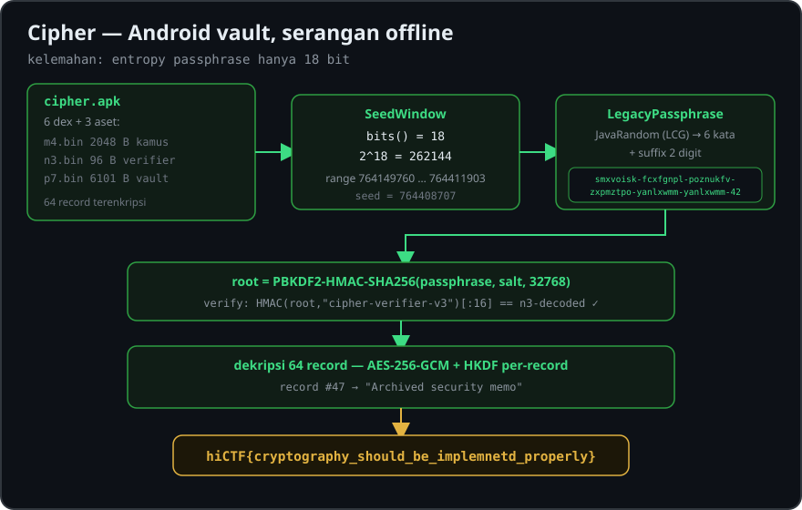

# Writeup — Cipher

| Informasi | Detail |
|---|---|
| Nama soal | **Cipher** |
| Event | **hiCTF 2026** |
| Author | **Hidden Investigations** |
| Kategori | **Android** (Reverse Engineering + Cryptography) |
| Poin | **62 pts** |
| Jumlah solves saat soal diberikan | **234** |
| Flag format | `hiCTF{...}` |
| File | `cipher.zip` → `cipher.apk` |
| SHA-256 `cipher.zip` | `d32ec3f2c705e1aefcba505d5f3af157680fe0bab50bc69418927c9298126745` |

<p align="center">
  
</p>

## Deskripsi

> A locked Android vault guards dozens of encrypted records behind a single passphrase.
> The interface reveals almost nothing, so inspect what lies beneath, understand how access
> is derived, and recover the secret hidden inside.

Challenge memberikan sebuah aplikasi Android yang berfungsi sebagai **vault**. Untuk membaca
record, aplikasi meminta master passphrase. Kita tidak perlu melakukan interaksi UI Android:
semua data terenkripsi, mekanisme pembuatan passphrase, serta verifikasi kunci berada
di dalam APK sehingga bisa dianalisis secara statis dan dipecahkan secara offline.

## 1. Ekstrak APK dan identifikasi aset

Ekstrak archive:

```bash
unzip cipher.zip
unzip -l cipher.apk
```

Terdapat enam berkas DEX (`classes.dex` hingga `classes6.dex`) dan tiga aset yang penting:

| Berkas | Ukuran | Fungsi |
|---|---:|---|
| `res/raw/m4.bin` | 2.048 byte | Kamus kata yang di-obfuscate |
| `res/raw/n3.bin` | 96 byte | Verifier HMAC yang disamarkan |
| `res/raw/p7.bin` | 6.101 byte | Vault berisi 64 record terenkripsi |

Kelas yang menjadi petunjuk utama:

- `com.hictf26.cipher.legacy.SeedWindow`
- `com.hictf26.cipher.legacy.Lexicon`
- `com.hictf26.cipher.legacy.LegacyPassphrase`
- `com.hictf26.cipher.crypto.AnchorReader`
- `com.hictf26.cipher.crypto.CryptoEngine`
- `com.hictf26.cipher.crypto.Hkdf`
- `com.hictf26.cipher.data.VaultStore`

## 2. Analisis ruang pencarian seed

Di kelas `SeedWindow`, ditemukan `bits() = 18`, sehingga ruang pencariannya
hanya **2^18 = 262.144** kemungkinan, bukan seluruh ruang password acak.

Fungsi `base()` ekuivalen dengan:

```python
a = 7283617
b = 1688791
rol = ((b << 7) | (b >> 25)) & 0xffffffff
combined = ((a ^ rol) + 681) & 0xffffffff
base = (((combined >> 11) ^ combined) & 0xfff) << 18
span = 1 << 18
```

Hasil:

```text
base = 764149760
span = 262144
range seed = 764149760 ... 764411903
```

Setelah mencocokkan setiap kandidat dengan verifier kriptografis, kandidat valid
yang didapat adalah:

```text
seed   = 764408707
offset = 258947
```

## 3. Rekonstruksi master passphrase

`Lexicon.load()` membaca `m4.bin` yang panjangnya 2.048 byte. Setiap byte didekode
dengan operasi XOR berikut:

```python
decoded[i] = encoded[i] ^ (
    ((i * 73 + 93) ^ ((i >> 3) * 17)) & 0xff
)
```

Data yang sudah didekode dipisahkan menjadi **256 kata, masing-masing 8 karakter**.

`LegacyPassphrase.fromSeed()` menggunakan `java.util.Random` dengan initial seed:

```python
seed_random = seed ^ 0x6A09E667F3BCC909
```

Enam kata diambil menggunakan `nextInt(256)`, kemudian digabung dengan tanda `-`.
Setelah itu dibuat akhiran dua digit:

```python
suffix = (random.nextInt(100) + 7 * seed.bit_count()) % 100
```

> Penting: algoritma `java.util.Random` tidak sama dengan modul `random`
> milik Python. Solver menirukan LCG Java secara tepat.

Untuk seed valid, hasilnya:

```text
smxvoisk-fcxfgnpl-poznukfv-zxpmztpo-yanlxwmm-yanlxwmm-42
```

## 4. Verifikasi root key

`p7.bin` diawali magic `V1LT`, versi `0x03`, lalu **16-byte salt**.
`CryptoEngine.deriveRoot()` menggunakan:

```text
PBKDF2-HMAC-SHA256
iterations = 32768
dkLen      = 32 byte (256 bit)
salt       = p7.bin[5:21]
```

Rumus:

```python
root = hashlib.pbkdf2_hmac(
    "sha256", passphrase.encode(), salt, 32768, dklen=32
)
```

Root key diperiksa dengan HMAC-SHA256 atas konteks `cipher-verifier-v3`.
`AnchorReader.readExpected()` mendekode nilai pembanding dari `n3.bin`:

```python
expected = bytes(
    n3[(i * 11 + 7) % 96] ^ ((i * 19 + 167) & 0xff)
    for i in range(16)
)
actual = hmac.new(root, b"cipher-verifier-v3", hashlib.sha256).digest()[:16]
```

Nilai expected dan actual cocok:

```text
f3840a2b902c711f0ac8f924c295e815
```

Artinya seed dan passphrase benar, bukan hasil tebakan terhadap format flag.

## 5. Dekripsi 64 record

Struktur `p7.bin` sesuai kode `VaultStore.load()`:

```text
4 byte   magic: "V1LT"
1 byte   version: 3
16 byte  salt
1 byte   jumlah record: 64

Untuk setiap record:
  1 byte    index
  12 byte   nonce
  2 byte    panjang ciphertext+tag (big-endian)
  N byte    ciphertext+tag
```

`CryptoEngine.decryptAll()` memperoleh key khusus tiap record menggunakan
HKDF satu blok berbasis HMAC-SHA256:

```python
prk = HMAC_SHA256(key=salt, message=root)
info = b"v1" + bytes([index])
record_key = HMAC_SHA256(key=prk, message=info + b"\x01")
```

Setiap record didekripsi dengan **AES-256-GCM**, nonce 12 byte, tag 16 byte
yang tersimpan di akhir ciphertext, dan AAD:

```python
aad = b"V1LT" + bytes([index])
```

Isi plaintext memakai karakter `\x1f` sebagai pemisah antara judul dan nilai.

Semua **64 record** berhasil didekripsi. Pada record indeks **47** (record ke-48),
ditemukan:

```text
Title: Archived security memo
Body : hiCTF{cryptography_should_be_implemnetd_properly}
```

## 6. Solver Python (reproducible)

Persyaratan:

```bash
python -m pip install cryptography
```

Simpan kode berikut sebagai `solve_cipher.py`, lalu letakkan bersebelahan
dengan `cipher.zip`:

```python
#!/usr/bin/env python3
"""Solver hiCTF 2026 / Cipher (Android)."""
import argparse
import hashlib
import hmac
import io
import re
import zipfile

from cryptography.hazmat.primitives.ciphers.aead import AESGCM

MASK48 = (1 << 48) - 1
FOUND_SEED = 764408707
VERIFY_CONTEXT = b"cipher-verifier-v3"


def load_resources(path="cipher.zip"):
    with zipfile.ZipFile(path) as source:
        apk_bytes = source.read("cipher.apk")
    with zipfile.ZipFile(io.BytesIO(apk_bytes)) as apk:
        return (
            apk.read("res/raw/m4.bin"),
            apk.read("res/raw/n3.bin"),
            apk.read("res/raw/p7.bin"),
        )


def dictionary(m4):
    assert len(m4) == 2048
    decoded = bytes(
        value ^ (((i * 73 + 93) ^ ((i >> 3) * 17)) & 0xff)
        for i, value in enumerate(m4)
    )
    return [decoded[i:i + 8].decode("ascii") for i in range(0, 2048, 8)]


class JavaRandom:
    def __init__(self, seed):
        self.state = (seed ^ 0x5DEECE66D) & MASK48

    def next(self, bits):
        self.state = (self.state * 0x5DEECE66D + 0xB) & MASK48
        return self.state >> (48 - bits)

    def next_int(self, bound):
        if bound & (bound - 1) == 0:
            return (bound * self.next(31)) >> 31
        while True:
            bits = self.next(31)
            value = bits % bound
            if bits - value + (bound - 1) < 2**31:
                return value


def password_from_seed(seed, words):
    rnd = JavaRandom(seed ^ 0x6A09E667F3BCC909)
    chosen = [words[rnd.next_int(256)] for _ in range(6)]
    suffix = (rnd.next_int(100) + 7 * seed.bit_count()) % 100
    return "-".join(chosen) + f"-{suffix:02d}"


def seed_window():
    a, b = 7283617, 1688791
    rol = ((b << 7) | (b >> 25)) & 0xffffffff
    combined = ((a ^ rol) + 681) & 0xffffffff
    base = (((combined >> 11) ^ combined) & 4095) << 18
    return base, 1 << 18


def verifier_from_n3(n3):
    assert len(n3) == 96
    return bytes(
        n3[(i * 11 + 7) % len(n3)] ^ ((i * 19 + 167) & 255)
        for i in range(16)
    )


def derive_checked(password, salt, expected):
    root = hashlib.pbkdf2_hmac(
        "sha256", password.encode("utf-8"), salt, 32768, dklen=32
    )
    actual = hmac.new(root, VERIFY_CONTEXT, hashlib.sha256).digest()[:16]
    return root if hmac.compare_digest(actual, expected) else None


def unlock_records(root, salt, p7):
    assert p7[:4] == b"V1LT" and p7[4] == 3
    count = p7[21]
    pos = 22
    prk = hmac.new(salt, root, hashlib.sha256).digest()
    plaintexts = []
    for _ in range(count):
        index = p7[pos]
        pos += 1
        nonce = p7[pos:pos + 12]
        pos += 12
        length = int.from_bytes(p7[pos:pos + 2], "big")
        pos += 2
        ciphertext_and_tag = p7[pos:pos + length]
        pos += length

        info = b"v1" + bytes([index])
        key = hmac.new(prk, info + b"\x01", hashlib.sha256).digest()
        aad = b"V1LT" + bytes([index])
        text = AESGCM(key).decrypt(nonce, ciphertext_and_tag, aad).decode("utf-8")
        title, body = text.split("\x1f", 1)
        plaintexts.append((index, title, body))
    assert pos == len(p7)
    return plaintexts


def main():
    parser = argparse.ArgumentParser()
    parser.add_argument("archive", nargs="?", default="cipher.zip")
    parser.add_argument("--bruteforce", action="store_true",
                        help="Search all 2^18 candidates (slow).")
    args = parser.parse_args()

    m4, n3, p7 = load_resources(args.archive)
    words = dictionary(m4)
    assert p7[:4] == b"V1LT" and p7[4] == 3
    salt = p7[5:21]
    expected = verifier_from_n3(n3)
    base, span = seed_window()

    if args.bruteforce:
        options = range(base, base + span)
    else:
        options = [FOUND_SEED]

    for seed in options:
        password = password_from_seed(seed, words)
        root = derive_checked(password, salt, expected)
        if root is not None:
            print("Seed:", seed, "(offset:", seed - base, ")")
            print("Passphrase:", password)
            plaintexts = unlock_records(root, salt, p7)
            print("Records decrypted:", len(plaintexts))
            for index, title, body in plaintexts:
                if re.search(r"hiCTF\{[^}]+\}", body):
                    print("Index:", index)
                    print("Title:", title)
                    print("FLAG:", re.search(r"hiCTF\{[^}]+\}", body).group())
            break
    else:
        raise RuntimeError("No matching seed found")


if __name__ == "__main__":
    main()
```

Jalankan untuk memverifikasi seed hasil analisis dan mendekripsi seluruh record:

```bash
python solve_cipher.py cipher.zip
```

Atau, untuk mencoba kembali seluruh ruang seed dari awal:

```bash
python solve_cipher.py cipher.zip --bruteforce
```

**Catatan:** mode `--bruteforce` dapat membutuhkan waktu lama karena setiap
kandidat menjalankan PBKDF2 sebanyak 32.768 iterasi. Mode tanpa argumen ini
menggunakan seed yang sudah ditemukan agar verifikasi hasil lebih cepat.

Contoh output dari eksekusi yang telah diuji:

```text
Seed: 764408707 (offset: 258947 )
Passphrase: smxvoisk-fcxfgnpl-poznukfv-zxpmztpo-yanlxwmm-yanlxwmm-42
Records decrypted: 64
Index: 47
Title: Archived security memo
FLAG: hiCTF{cryptography_should_be_implemnetd_properly}
```

## Kesimpulan

Kelemahannya bukan terletak pada AES-GCM atau implementasi PBKDF2 secara langsung,
melainkan pada **entropy passphrase yang berasal dari seed berukuran hanya 18 bit**.
Seluruh pembentukan passphrase, salt, serta verifier tersimpan di aplikasi, sehingga
penyerang dapat menguji kandidat tanpa berinteraksi dengan UI atau server.

Setelah root key ditemukan, seluruh record dapat didekripsi secara offline,
termasuk record yang menyimpan flag.

## Flag

```text
hiCTF{cryptography_should_be_implemnetd_properly}
```

> Perhatikan ejaan `implemnetd` — itu memang isi plaintext yang ditemukan dan
> tidak boleh dikoreksi ketika submit flag.
