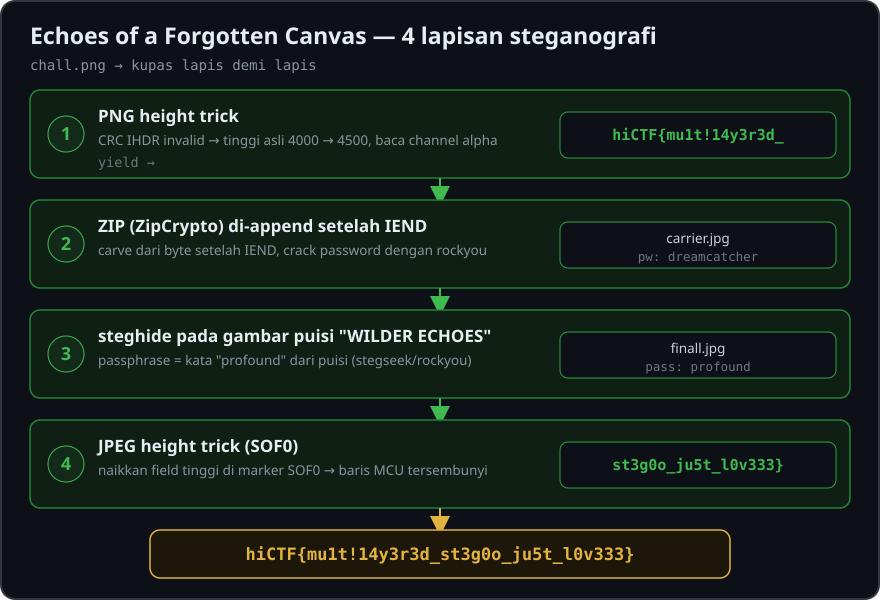

# Echoes of a Forgotten Canvas

- **Category:** Steganography
- **Points:** 59
- **Solves:** 306
- **Author:** Hidden Investigations
- **Flag:** `hiCTF{mu1t!14y3r3d_st3g0o_ju5t_l0v333}`

<p align="center">
  
</p>

## Deskripsi

> A seemingly ordinary file has surfaced with traces of something unusual. It may look complete at first glance, but appearances can be deceiving. Explore the artifact carefully and uncover what was left behind.

File: `echoes-of-a-forgotten-canvas.zip` → berisi `chall.png` (PNG 4000×4000, RGBA).

Sesuai judulnya ("multi-layered"), flag terbagi dalam beberapa **lapisan** steganografi yang saling bersarang.

---

## Layer 1 — PNG height trick (bagian pertama flag)

Cek CRC tiap chunk PNG, CRC pada **IHDR** ternyata tidak valid — tanda klasik bahwa **dimensi gambar diubah** untuk menyembunyikan sebagian kanvas.

```python
import struct, zlib
d = open('chall.png','rb').read()
p = 8
while True:
    l = struct.unpack('>I', d[p:p+4])[0]; t = d[p+4:p+8]
    crc = struct.unpack('>I', d[p+8+l:p+12+l])[0]
    if zlib.crc32(d[p+4:p+8+l]) != crc:
        print('BAD CRC', t, p)   # -> BAD CRC IHDR
    p += 12 + l
    if t == b'IEND': break
```

Brute-force lebar/tinggi asli agar cocok dengan CRC IHDR:

```python
ih = d[12:29]; crc = struct.unpack('>I', d[29:33])[0]
for w in range(1,10000):
    for h in range(1,10000):
        if zlib.crc32(b'IHDR'+struct.pack('>II',w,h)+ih[12:]) == crc:
            print(w, h)   # -> 4000 4500
```

Tinggi asli = **4500** (bukan 4000). Perbaiki tinggi, lalu baris 4000–4500 yang tadinya tersembunyi memunculkan teks di **channel alpha** (teks hitam opaque di atas area transparan):

```python
d = bytearray(open('chall.png','rb').read())
d[20:24] = struct.pack('>I', 4500)        # patch tinggi di IHDR
open('fixed.png','wb').write(d)

from PIL import Image; import numpy as np
a = np.array(Image.open('fixed.png'))
b = a[4000:,:,3]                          # channel alpha area tersembunyi
Image.fromarray(255-b).save('alpha.png')  # invert -> teks terbaca
```

Hasil → **bagian pertama flag:**

```
hiCTF{mu1t!14y3r3d_
```

---

## Layer 2 — ZIP terenkripsi di belakang IEND

Setelah chunk `IEND`, ada data yang di-*append* — sebuah arsip **ZIP** berisi `carrier.jpg`:

```
PK\x03\x04 ... carrier.jpg
```

Carve dan cek: ZIP memakai enkripsi tradisional **ZipCrypto** (`general purpose flag = 0x0009`, method = 8/deflate).

```python
# carve mulai dari byte setelah IEND
open('hidden.zip','wb').write(d[p:])   # p = posisi akhir IEND
```

Pecahkan password dengan wordlist `rockyou.txt`:

```bash
# (john/zip2john atau brute-force cepat berbasis check-byte DOS-time)
# password ditemukan:
dreamcatcher
```

> Catatan: karena entry memakai *data descriptor* (bit 3 di-set), byte verifikasi ZipCrypto = **high byte dari waktu modifikasi DOS**, bukan high byte CRC.

```bash
unzip -P dreamcatcher hidden.zip   # -> carrier.jpg (gambar puisi "WILDER ECHOES")
```

---

## Layer 3 — steghide pada gambar puisi

`carrier.jpg` berisi puisi **"WILDER ECHOES"** di atas kertas. Puisi ini petunjuk: kata **"profound"** muncul dua kali ("a profound, healing breath", "A profound stillness") — ini passphrase steghide.

Konfirmasi & crack dengan `stegseek` + rockyou:

```bash
stegseek carrier.jpg rockyou.txt
# [i] Found passphrase: "profound"
# [i] Original filename: "finall.jpg"
```

Atau langsung:

```bash
steghide extract -sf carrier.jpg -p profound -xf finall.jpg
```

Keluar `finall.jpg` — foto lorong kota ("Apartments Gajeta", Trogir/Kroasia).

---

## Layer 4 — JPEG height trick (bagian kedua flag)

`finall.jpg` bersih dari steghide/append/LSB (dicek dengan `stegseek --seed`, `binwalk`, bit-plane, stegoveritas → nihil). Nama file **"finall"** = *final*, jadi flag ada di sini.

Trik yang sama seperti Layer 1, tapi untuk **JPEG**: tinggi gambar di marker **SOF0** dipalsukan. Menaikkan field tinggi memunculkan baris MCU tersembunyi di bawah gambar.

```python
import struct
d = bytearray(open('finall.jpg','rb').read())
i = d.find(b'\xff\xc0')                 # marker SOF0
h, w = struct.unpack('>HH', d[i+5:i+9]) # h=647 w=495
d[i+5:i+7] = struct.pack('>H', 1536)    # naikkan tinggi
open('tall.jpg','wb').write(d)

from PIL import Image, ImageFile
ImageFile.LOAD_TRUNCATED_IMAGES = True
im = Image.open('tall.jpg'); im.load()
im.convert('RGB').save('tall.png')      # teks muncul di area abu-abu bawah
```

Area tambahan menampilkan **bagian kedua flag:**

```
st3g0o_ju5t_l0v333}
```

---

## Flag

Gabungkan kedua bagian:

```
hiCTF{mu1t!14y3r3d_st3g0o_ju5t_l0v333}
```

## Ringkasan lapisan

| # | Teknik | Hasil |
|---|--------|-------|
| 1 | PNG height trick (CRC IHDR salah → 4000×4500) | `hiCTF{mu1t!14y3r3d_` (channel alpha) |
| 2 | ZIP ZipCrypto di-append setelah IEND | `carrier.jpg` (pw: `dreamcatcher`) |
| 3 | steghide pada gambar puisi | `finall.jpg` (pass: `profound`) |
| 4 | JPEG height trick (SOF0 height) | `st3g0o_ju5t_l0v333}` |

## Tools

`python/PIL`, `zlib`, `unzip`, `rockyou.txt`, `stegseek`, `steghide`, `binwalk`, `stegoveritas`.

## Takeaway

Pola "height trick" (tweak dimensi di IHDR untuk PNG dan di SOF0 untuk JPEG) dipakai dua kali di awal dan akhir — bungkusnya diselingi ZipCrypto dan steghide. Selalu cek: validitas CRC/header, data setelah penanda akhir file (IEND/EOI), channel alpha, dan field dimensi gambar.
