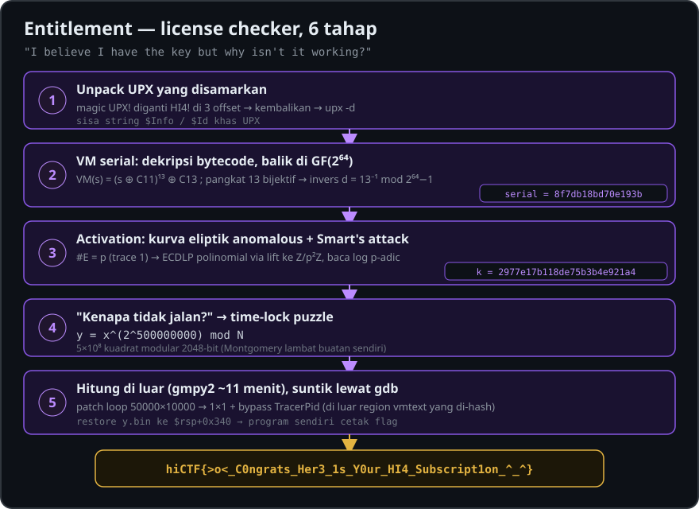

# Writeup Entitlement — hiCTF 2026

**Nama soal:** Entitlement
**Kategori:** Reverse Engineering
**Poin:** 60
**Pembuat:** Hidden Investigations

<p align="center">
  
</p>

---

## Info soal

Flag: `hiCTF{>o<_C0ngrats_Her3_1s_Y0ur_HI4_Subscript1on_^_^}`. Kuncinya memang benar, tapi program "tidak bekerja" karena setelah validasi ia menjalankan time-lock puzzle 5×10⁸ kuadrat modular 2048-bit.

| Atribut | Nilai |
| --- | --- |
| Nama soal | Entitlement |
| Kategori | Reverse Engineering |
| Poin | 60 |
| Pembuat | Hidden Investigations |
| File | `entitlement.zip` → `Entitlement` (ELF 64-bit, x86-64) |
| SHA-256 zip | `d468c69996ba1e34344d616d3f0ccf1fb2de6367a498a0dda4be67041a8feca0` |
| Format flag | `hiCTF{}` |

Deskripsi:

> Recovered a licence checker from a vendor who takes their intellectual property very seriously. I believe I have the key but why isn't it working?

Alur solusi singkat:

1. Unpack UPX yang magic-nya diganti `HI4!`.
2. Dekripsi bytecode VM, lalu balik fungsi serial di GF(2⁶⁴).
3. Pecahkan logaritma diskret kurva eliptik anomalous dengan Smart's attack untuk activation code.
4. Hitung time-lock puzzle di luar program dengan gmpy2, lalu suntikkan hasilnya lewat gdb.

---

## Tahap 1 — Unpack UPX yang disamarkan

Binary dipacking UPX, tapi magic `UPX!` diganti `HI4!` supaya `upx -d` menolak. Tandanya: `file` menyebut *statically linked, no section header*, string hampir semuanya acak, dan masih ada sisa string `$Info: ... $` / `$Id: ... $` khas UPX.

```bash
$ file Entitlement
Entitlement: ELF 64-bit LSB executable, x86-64, statically linked, no section header
$ od -A x -t x1z Entitlement | sed -n 26p
000190 ... f9 79 c3 51 48 49 34 21   >.y.QHI4!<
```

Magic `HI4!` muncul di tiga offset (412, 15002, 15012). Ganti semuanya kembali menjadi `UPX!`, lalu unpack:

```python
d = open('Entitlement', 'rb').read()
open('patched', 'wb').write(d.replace(b'HI4!', b'UPX!'))
```

```bash
$ upx -d patched -o unpacked
     32319 <-     15048   46.56%   linux/amd64   unpacked
```

Hasilnya ELF dinamis yang stripped, dengan string penting: `Serial > `, `Activation code > `, `Correct! The flag is %s`, `Incorrect...`, `/proc/self/status`, `TracerPid:`, serta section khusus bernama `vmtext`.

---

## Tahap 2 — Peta fungsi main (0x401110)

Main memeriksa dua input lalu menurunkan flag dari keduanya. Sebelum main, sebuah constructor (0x4010e0) memanggil `prctl(PR_SET_DUMPABLE, 0)` dan menutup fd 3–255 sebagai anti-debug ringan.

| Langkah | Alamat | Isi |
| --- | --- | --- |
| Serial | 0x401139 | `scanf("%s")`, harus 16 karakter hex → nilai 64-bit `s` |
| Init VM | 0x404330 | Dekripsi bytecode VM (sekali saja, flag global 0x40721c) |
| Cek serial | 0x404560 (`vmtext`) | `VM(s) == 0x30cefbec2e4bc466` |
| Activation | 0x40123c | Harus 25 karakter hex → nilai 100-bit `k` |
| Cek activation | 0x4012b6–0x401494 | Double-and-add `k·G` (fungsi add 0x403ad0) harus sama dengan titik `Q` |
| Turunan kunci | 0x4014a2–0x40157c | `s` dan `k` di-hash (0x401cb0) 8 kali → 256 byte `x` |
| Time-lock | 0x4037b0 | `y = x^(2^500000000) mod N` |
| Flag | 0x4015f9–0x4016b5 | Hash `y`, XOR dengan data 0x405200, cek jumlah byte = 0x133d, cetak flag |

Konstanta target titik `Q` terlihat langsung di perbandingan akhir:

```nasm
movabs rax, 0xebad9c83dd402304   ; Qx (64 bit bawah)
mov    eax, 0xc45a03ef
shl    rax, 3                    ; Qx (bagian atas) = 0x622d01f78
movabs rcx, 0x3c1ef33f165880b6   ; Qy (64 bit bawah)
xor    rdx, 0x387932a1           ; Qy (bagian atas)
```

---

## Tahap 3 — VM serial: dekripsi bytecode, lalu balik di GF(2⁶⁴)

Serial = `8f7db18bd70e193b`. Pemeriksanya adalah VM kecil di section `vmtext` yang menjalankan 0x18c byte bytecode terenkripsi di 0x407080.

### Dekripsi bytecode (0x404330)

Kunci dekripsi diambil dari hash byte-byte kode `vmtext` sendiri (anti-tamper: software breakpoint di VM akan merusak kunci). Kalau `TracerPid` di `/proc/self/status` bukan 0 (sedang di-debug), kunci di-XOR lagi dengan `0xa66de8df3249dfe4`, sehingga bytecode jadi sampah.

```python
M = (1 << 64) - 1
h = 0x80a86c0cba674b51
for b in code_vmtext:                    # 0x404560..0x404702
    a = ((b ^ h) * 0x4ab4302c37aa6cbd) & M
    h = (a >> 31) ^ a

def keystream(seed, n):                  # xorshift64 (>>10, <<24, >>11)
    out, s = bytearray(), seed
    while len(out) < n:
        x = (s >> 10) ^ s
        x = ((x << 24) & M) ^ x
        s = (x >> 11) ^ x
        out += s.to_bytes(8, 'little')
    return out[:n]

bytecode = bytes(a ^ b for a, b in zip(enc_bytecode, keystream(h, 0x18c)))
```

Karena semuanya statis, dekripsi bisa dilakukan di Python tanpa menjalankan program.

### Instruction set

Setiap instruksi 4 byte `op, d, a, b`, dengan 8 register 64-bit dan tabel konstanta `C` di 0x405240. Jump table di 0x405060 memberi 17 opcode:

| Op | Arti | Op | Arti |
| --- | --- | --- | --- |
| 0 | exit | 9 | `r[d] <<= b` |
| 1 | `r[d] = C[a]` | 10 | `r[d] >>= b` |
| 2 | `r[d] = input` | 11 | `r[d] += r[a]` |
| 3 | `r[d] = r[a]` | 12 | `r[d] -= b` |
| 4 | `r[d] ^= r[a]` | 13 | `jnz r[d], (b<<8)\|a` |
| 5 | `r[d] ^= C[a]` | 14 | `jmp (b<<8)\|a` |
| 6 | `r[d] = ~r[d]` | 15 | `r[d] = C[r[a] & 63]` |
| 7 / 8 | `rol` / `ror` | 16 | `return r[d]` |

### Arti program

Disassembly bytecode menunjukkan lima blok perkalian shift-and-xor 64 kali dengan reduksi polinom `0x2b395c2099596d9f`, yaitu perkalian di GF(2⁶⁴). Rantainya x² → x³ → x⁶ → x¹² → x¹³, sehingga:

$$\mathrm{VM}(s) = (s \oplus C_{11})^{13} \oplus C_{13}$$

dengan C11 = `0xd1705c3b2e33689b` dan C13 = `0xba6b1f3cb925c25a`. Model ini cocok 100% dengan emulator VM pada input acak.

### Inversi

FPB(13, 2⁶⁴−1) = 1, jadi pangkat 13 adalah bijeksi dan bisa dibalik dengan d = 13⁻¹ mod (2⁶⁴−1):

```python
P = 0x2b395c2099596d9f

def gf_mul(a, b):
    r = 0
    for i in range(63, -1, -1):
        top = r >> 63
        r = (r << 1) & M
        if top: r ^= P
        if (b >> i) & 1: r ^= a
    return r

def gf_pow(a, e):
    r = 1
    while e:
        if e & 1: r = gf_mul(r, a)
        a = gf_mul(a, a); e >>= 1
    return r

d = pow(13, -1, 2**64 - 1)
s = gf_pow(0x30cefbec2e4bc466 ^ C13, d) ^ C11
# s = 0x8f7db18bd70e193b ; VM(s) == 0x30cefbec2e4bc466 ✔
```

---

## Tahap 4 — Activation code: kurva eliptik anomalous + Smart's attack

Activation code = `2977e17b118de75b3b4e921a4`. Program menghitung k·G dengan double-and-add di atas kurva y² = x³ + ax + b, dan hasilnya harus sama dengan Q.

### Parameter kurva

Konstanta diambil dari fungsi field (0x4017c0 mulmod, 0x403900 inverse Fermat dengan eksponen p−2) dan point add (0x403ad0). Nilai b tidak tertulis di binary, tapi dihitung dari G dan hasilnya sama persis bila dihitung dari Q.

| Parameter | Nilai |
| --- | --- |
| p (100 bit, prima) | `0x8c817b4a4c0f170cd5aab18cf` |
| a | `0x65561c079c3bb669feb4d54d9` |
| b | `0x3905920c79c2f7ace28164fb6` |
| G (0x405670) | (`0xc217d88d4bf005f2022d4e0f`, `0x30999f70fb48e2b703431f4d0`) |
| Q | (`0x622d01f78ebad9c83dd402304`, `0x387932a13c1ef33f165880b6`) |

### Kelemahan: #E = p

PARI `ellcard` memberi orde kurva 695750960437370813140792187087, prima dan **sama dengan p**. Kurva seperti ini disebut *anomalous* (trace Frobenius = 1). Logaritma diskretnya bisa dipecahkan dalam waktu polinomial dengan **Smart's attack**: angkat titik ke Z/p²Z, kalikan dengan p, lalu baca logaritma p-adik dari koordinat grup formal.

Rincian implementasi:

1. Angkat kurva secara acak: a' = a + p·r₁ dan b' = b + p·r₂ (acak supaya tidak kena *canonical lift*).
2. Angkat tiap titik dengan Hensel: y' = y + p·t, dengan t = ((x³ + a'x + b' − y²)/p)·(2y)⁻¹ mod p.
3. Hitung (p−1)·P' mod p². Penjumlahan terakhir dengan P' memiliki x₂ − x₁ = p·u, sehingga λ = L/p dengan L = (y₂ − y₁)·u⁻¹.
4. Parameter grup formal t = −x/y ≡ p/L, jadi φ(P) = L⁻¹ mod p.
5. k = φ(Q)·φ(G)⁻¹ mod p.

```python
import random

def add(P, Q, A, m):
    if P is None: return Q
    if Q is None: return P
    x1, y1 = P; x2, y2 = Q
    if (x1 - x2) % m == 0:
        if (y1 + y2) % m == 0: return None
        l = (3*x1*x1 + A) * pow(2*y1, -1, m) % m
    else:
        l = (y2 - y1) * pow(x2 - x1, -1, m) % m
    x3 = (l*l - x1 - x2) % m
    return (x3, (l*(x1 - x3) - y1) % m)

def mul(k, P, A, m):
    R = None
    while k:
        if k & 1: R = add(R, P, A, m)
        P = add(P, P, A, m); k >>= 1
    return R

def smart(r1, r2):
    m = p*p; A = a + p*r1; B = b + p*r2
    def lift(x, y):
        t = ((x**3 + A*x + B - y*y) % m) // p * pow(2*y, -1, p) % p
        return (x, y + p*t)
    def phi(P):
        P1 = lift(*P)
        R = mul(p - 1, P1, A, m)
        x1, y1 = P1; x2, y2 = R
        u = ((x2 - x1) % m) // p
        L = (y2 - y1) * pow(u, -1, p) % p
        return pow(L, -1, p)
    return phi(Q) * pow(phi(G), -1, p) % p

k = smart(random.randrange(p), random.randrange(p))
# k = 0x2977e17b118de75b3b4e921a4 (98 bit)
assert mul(k, G, a, p) == Q   # ✔
```

Catatan: k + p = `b5f95cc55d9cfe6810f943a73` juga 25 digit hex dan lolos cek titik. Kandidat yang benar ditentukan oleh checksum flag; ternyata yang benar adalah k itu sendiri.

---

## Tahap 5 — "Kenapa key-nya tidak bekerja?": time-lock puzzle

Dengan serial dan activation yang benar, program tetap terlihat hang (timeout 100 detik tanpa output). Penyebabnya fungsi 0x4037b0, yang merupakan time-lock puzzle gaya Rivest–Shamir–Wagner.

```nasm
4037c2: mov ebp, 0xc350        ; 50.000 (loop luar)
4037e9: call 4021e0            ; t = MontMul(x, R²)   -> bentuk Montgomery
4037f0: mov ebx, 0x2710        ; 10.000 (loop dalam)
403801: call 4021e0            ; t = MontMul(t, t)    -> kuadrat
40381f: call 4021e0            ; y = MontMul(t, 1)    -> keluar dari Montgomery
```

Total ada 50.000 × 10.000 = 5×10⁸ kuadrat modular 2048-bit, dengan implementasi Montgomery buatan sendiri yang lambat:

$$y = x^{2^{500000000}} \bmod N$$

Main juga membersihkan byte teratas input (`and [rsp+0x338], 0x00ffffffffffffff`) supaya x < N.

### Mengambil modulus N

N tidak disimpan di data, tetapi di-inline sebagai 32 immediate `movabs` di dalam fungsi 0x4021e0, ditambah `n0' = 0x7b01dbb64d15f19d`. Dua pengecekan memastikan rekonstruksinya benar:

- `n0' · N[0] ≡ −1 (mod 2⁶⁴)` ✔
- Konstanta R² di 0x405440 sama dengan `2^4096 mod N` ✔

Jalan pintasnya adalah menghitung 2^T mod φ(N), tapi itu butuh faktorisasi N. Fermat (2 juta iterasi), trial division sampai 10⁶, dan Pollard p−1 (B = 200.000) semuanya gagal, jadi N dianggap RSA yang kuat.

---

## Tahap 6 — Hitung di luar program, lalu suntikkan lewat gdb

GMP jauh lebih cepat daripada implementasi Montgomery di binary. Benchmark gmpy2 memperkirakan sekitar 1.000 detik, dan pada praktiknya selesai dalam **11 menit**.

### 1. Patch binary agar bisa di-debug dan cepat

Semua patch berada di luar `vmtext`, jadi hash anti-tamper tidak berubah.

| Alamat | Asli | Patch | Tujuan |
| --- | --- | --- | --- |
| 0x403830 | `push r12; xor esi,esi` | `xor eax,eax; ret` | Cek TracerPid selalu 0, VM tetap terdekripsi benar di bawah gdb |
| 0x4037c2 | `mov ebp, 0xc350` | `mov ebp, 1` | Loop luar 1 kali |
| 0x4037f0 | `mov ebx, 0x2710` | `mov ebx, 1` | Loop dalam 1 kali |

```python
B = bytearray(open('unpacked', 'rb').read())
def patch(va, new): o = va - 0x400000; B[o:o+len(new)] = new
patch(0x403830, bytes.fromhex('31c0c390'))      # xor eax,eax; ret
patch(0x4037c2, bytes.fromhex('bd01000000'))    # mov ebp,1
patch(0x4037f0, bytes.fromhex('bb01000000'))    # mov ebx,1
open('ent_fast', 'wb').write(B)
```

### 2. Ambil x dan validasi semantik

Breakpoint dipasang di 0x4015a0 (sebelum `call 0x4037b0`) dan 0x4015a5 (setelahnya). Buffer x di `rsp+0x240` dan hasil y di `rsp+0x340`, masing-masing 256 byte little-endian. Dengan T = 1, y yang keluar sama dengan x² mod N, jadi modelnya benar.

```gdb
break *0x4015a0
break *0x4015a5
run < in.txt
dump binary memory x.bin $rsp+0x240 $rsp+0x340
continue
dump binary memory y1.bin $rsp+0x340 $rsp+0x440
```

### 3. Hitung time-lock dengan gmpy2

```python
import gmpy2
x = gmpy2.mpz(int.from_bytes(open('x.bin', 'rb').read(), 'little'))
y = gmpy2.powmod(x, gmpy2.mpz(2)**500000000, N)   # ~11 menit
open('y.bin', 'wb').write(int(y).to_bytes(256, 'little'))
```

### 4. Suntikkan y dan biarkan program mencetak flag

```gdb
break *0x4015a5
run < in.txt
restore y.bin binary $rsp+0x340
continue
```

```text
$ printf '8f7db18bd70e193b\n2977e17b118de75b3b4e921a4\n' > in.txt
$ gdb -q -batch -x inject.gdb ./ent_fast
Serial > Activation code > Correct! The flag is hiCTF{>o<_C0ngrats_Her3_1s_Y0ur_HI4_Subscript1on_^_^}
```

Cara ini tidak perlu menulis ulang fungsi hash dan dekripsi flag di Python, karena program sendiri yang menyelesaikan sisanya setelah y disuntikkan.

---

## Flag dan pelajaran

```text
hiCTF{>o<_C0ngrats_Her3_1s_Y0ur_HI4_Subscript1on_^_^}
```

| Input | Nilai |
| --- | --- |
| Serial | `8f7db18bd70e193b` |
| Activation code | `2977e17b118de75b3b4e921a4` |

Pelajaran dari soal ini:

- Packer bisa disamarkan hanya dengan mengganti magic. Sisa string `$Info`/`$Id` dan struktur header UPX tetap jadi petunjuk.
- Anti-tamper berbasis hash kode bisa dilewati dengan analisis statis atau hardware breakpoint. Patch boleh dilakukan di luar region yang di-hash.
- Selalu cek orde kurva. #E = p (anomalous) membuat ECDLP mudah dengan Smart's attack, berapa pun ukuran p-nya.
- Time-lock puzzle tidak bisa diparalelkan, tapi implementasi yang sengaja lambat bisa diganti GMP. Hasilnya tinggal disuntikkan ke memori, jadi tidak perlu re-implementasi hash dan dekripsi flag.

Tools: `upx` 4.2.4, `objdump`, `gdb`, Python 3 + `cypari2` (orde kurva) + `gmpy2` (time-lock).
