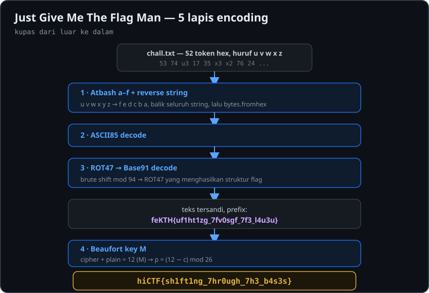

# Just Give Me The Flag Man

| | |
|---|---|
| **Kategori** | Cryptography |
| **Author** | Hidden Investigations |
| **Poin** | 60 |
| **Solves** | 265 |
| **Flag** | `hiCTF{sh1ft1ng_7hr0ugh_7h3_b4s3s}` |

<p align="center">
  
</p>

## Deskripsi

> Saad lowered his voice and glanced over his shoulder.
> **Saad:** You got the note?
> **Harun:** The one with the strange code? I almost burned it.
> **Saad:** Don't. Someone has been watching the building since noon.
> **Harun:** What does it say?

File: `chall.zip`
SHA-256: `47250d4a65be0eb4ff5e8b4c31ae2120f95bb086f301ebb2467f7640614952c0`
Format flag: `hiCTF{}`

## Ringkasan

Flag dibungkus 5 lapis encoding/cipher:

```
chall.txt
  └─ Hex (huruf a–f diganti u–z secara terbalik / Atbash)
      └─ Reverse string
          └─ ASCII85
              └─ ROT47 → Base91
                  └─ Beaufort (kunci "M")
                      └─ hiCTF{sh1ft1ng_7hr0ugh_7h3_b4s3s}
```

## Analisis

### 0. Isi file

Zip-nya cuma berisi `chall.txt`:

```
53 74 u3 17 35 x3 x2 76 24 33 93 u3 16 v4 36 v4 93 32 64 22 z3 x2 42 w4 54 05 v2 v5 63 v6 26 23 26 33 86 u3 33 x3 74 x2 06 54 62 x5 22 74 44 04 45 v5 93 x2
```

Ada 52 token, masing-masing 2 karakter, isinya digit `0–9` plus huruf `u v w x z` (`y` kebetulan tidak muncul). Ada 6 huruf `u–z` dan juga 6 digit hex `a–f`, jadi kuat dugaan ini **hex yang huruf a–f-nya disubstitusi**.

### 1. Hex yang dibalik

Kalau tiap token dibaca normal (karakter pertama = high nibble), token seperti `93`, `86`, atau `u3` menghasilkan byte non-ASCII. Kalau dibaca terbalik, **karakter kedua selalu 2–7**. Artinya karakter kedua adalah high nibble, dan semua byte jatuh di rentang ASCII printable (`0x20–0x7F`).

Jadi **seluruh string hex dibalik** (reverse karakter per karakter), lalu huruf hanya muncul di posisi low nibble.

### 2. Pemetaan huruf (Atbash pada a–f)

Pemetaan huruf ke digit hex belum diketahui. Saya brute-force semua kemungkinan pemetaan, decode hasilnya sebagai ASCII85 (karakternya ada di rentang `!`–`u`, khas ASCII85), lalu nilai berdasarkan persentase byte printable. Cuma satu pemetaan yang menghasilkan output **100% printable**:

| Cipher | u | v | w | x | y | z |
|---|---|---|---|---|---|---|
| Hex    | f | e | d | c | b | a |

Urutannya terbalik, jadi ini Atbash pada alfabet `a–f`.

Setelah huruf diganti dan string dibalik, decode hex menghasilkan:

```
,9^T@DG"\&E`,G<3?h3b2bn6^.PEM$,:"F#9NcNa?93Bg,<Sq?G5
```

### 3. ASCII85

```
#!dvnJk6rRHc9"NB7NnI*/1##$!DLYv$^:z3#<Tjw
```

Hasil ini juga printable semua, tapi ada karakter `v`, `w`, `z` di atas `u`, jadi bukan ASCII85 lagi. Rentang karakternya (`!`–`z`) cocok untuk Base91/Base92. Tapi decode Base91/Base92 langsung gagal atau menghasilkan sampah.

### 4. ROT47 → Base91

Saya coba semua pergeseran Caesar di rentang ASCII printable (mod 94) sebelum decode. Yang menghasilkan teks bermakna adalah **ROT47**:

```
ROT47 : RP5G?y<eC#w4hQ}qf}?xY^`RRSPs{*GS/iKbRk%;H
Base91: feKTH{uf1ht1zg_7fv0sgf_7f3_l4u3u}
```

Strukturnya sudah seperti flag (`XXXXX{...}`), tapi hurufnya masih tersandi.

### 5. Beaufort dengan kunci `M`

Bandingkan prefix `feKTH` dengan `hiCTF` (A=0 … Z=25):

| Cipher | f (5) | e (4) | K (10) | T (19) | H (7) |
|---|---|---|---|---|---|
| Plain  | h (7) | i (8) | C (2)  | T (19) | F (5) |
| Jumlah mod 26 | 12 | 12 | 12 | 12 | 12 |

Jumlah cipher + plain selalu **12 (`M`)**. Ini ciri **Beaufort cipher** dengan kunci tunggal `M`:

```
p = (12 − c) mod 26
```

Angka dan simbol tidak berubah. Hasilnya:

```
hiCTF{sh1ft1ng_7hr0ugh_7h3_b4s3s}
```

Isi flag-nya ("shifting through the bases") sesuai dengan cara soal ini dibuat: base encoding berlapis yang diselingi berbagai bentuk shift/substitusi.

## Solver

```python
#!/usr/bin/env python3
# pip install base91
import base64, base91

data = open("chall.txt").read().split()

# 1. Hex dengan huruf Atbash: u v w x y z -> f e d c b a
hexstr = "".join(data).translate(str.maketrans("uvwxyz", "fedcba"))

# 2. Reverse seluruh string hex lalu decode
l1 = bytes.fromhex(hexstr[::-1]).decode()

# 3. ASCII85
l2 = base64.a85decode(l1).decode()

# 4. ROT47 lalu Base91
rot47 = "".join(chr(33 + (ord(c) - 33 + 47) % 94) for c in l2)
l3 = bytes(base91.decode(rot47)).decode()

# 5. Beaufort kunci 'M'  ->  p = (12 - c) mod 26
def beaufort(s, k=12):
    out = ""
    for ch in s:
        if ch.isalpha():
            b = 65 if ch.isupper() else 97
            out += chr(b + (k - (ord(ch) - b)) % 26)
        else:
            out += ch
    return out

print(beaufort(l3))
```

Output:

```
$ python3 solve.py
hiCTF{sh1ft1ng_7hr0ugh_7h3_b4s3s}
```

## Flag

```
hiCTF{sh1ft1ng_7hr0ugh_7h3_b4s3s}
```
