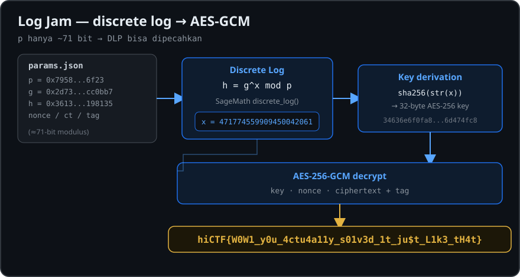

# Log Jam — hiCTF 2026

<p align="center">
  
</p>

## Challenge

**Name:** Log Jam  
**Category:** Cryptography  
**Flag format:** `hiCTF{}`

> Someone forgot to shred their logs.
>
> We caught an encrypted transmission leaving an adversary's network. The recovery was messy, but everything we salvaged is in `params.json`.
>
> Find the key. Read the message.

## Files

`logjam.zip`

SHA-256:

```text
25350191fa48891bf7ef70202a283fbbb9ea1d9c1c8904b5a5a4d09903fccfee
```

Isi arsip hanya berisi:

```text
params.json
```

Parameter penting di dalam file:

```json
{
  "p": "7958085483c2736f23",
  "g": "2d738b6682dacc0bb7",
  "h": "36130f3996b8198135",
  "nonce": "786fe3b966eb9949d0ded089",
  "ciphertext": "dec59383508c24b2aa7c5ec44407720c8ac385af2dbc157b59a4113056f6b0b49abe300e822ffed923516e0d8eb77d49b55f",
  "tag": "469442d8157214b3ba95136e3a7e8082"
}
```

## Analisis

Adanya parameter `p`, `g`, dan `h` mengarah ke persoalan discrete logarithm:

```text
h = g^x mod p
```

Tujuannya adalah mendapatkan nilai rahasia `x`.

Nilai modulusnya:

```text
p = 2238399445918886883107
```

Ukuran `p` hanya sekitar 71 bit, sehingga discrete logarithm ini masih cukup kecil untuk diselesaikan menggunakan software matematika seperti SageMath.

Faktorisasi order grup:

```text
p - 1 = 2 × 1119199722959443441553
```

Dengan SageMath, nilai `x` dapat dicari menggunakan `discrete_log()`:

```python
p = Integer(0x7958085483c2736f23)
g = Integer(0x2d738b6682dacc0bb7)
h = Integer(0x36130f3996b8198135)

x = discrete_log(Mod(h, p), Mod(g, p))
print(x)
```

Hasil:

```text
471774559909450042061
```

Verifikasi:

```python
assert pow(int(g), int(x), int(p)) == int(h)
```

Jadi secret key material yang kita cari adalah:

```text
x = 471774559909450042061
```

## Derivasi AES Key

Key AES dibuat dengan SHA-256 dari representasi decimal `x`:

```python
from hashlib import sha256

key = sha256(str(x).encode()).digest()
print(key.hex())
```

Hasil:

```text
34636e6f0fa8e0313e3d6ca22002df2e051e1cfd6d35cd881cad6f4f6d474fc8
```

Panjang key adalah 32 byte, sehingga cocok sebagai AES-256 key.

Parameter `nonce`, `ciphertext`, dan `tag` menunjukkan bahwa pesan menggunakan AES-GCM.

## Decrypt

Solver lengkap:

```python
from hashlib import sha256
from cryptography.hazmat.primitives.ciphers.aead import AESGCM

p = int("7958085483c2736f23", 16)
g = int("2d738b6682dacc0bb7", 16)
h = int("36130f3996b8198135", 16)

# hasil discrete logarithm
x = 471774559909450042061

assert pow(g, x, p) == h

key = sha256(str(x).encode()).digest()

nonce = bytes.fromhex(
    "786fe3b966eb9949d0ded089"
)

ciphertext = bytes.fromhex(
    "dec59383508c24b2aa7c5ec44407720c8ac385af2dbc157b59a4113056f6b0b"
    "49abe300e822ffed923516e0d8eb77d49b55f"
)

tag = bytes.fromhex(
    "469442d8157214b3ba95136e3a7e8082"
)

aes = AESGCM(key)
plaintext = aes.decrypt(nonce, ciphertext + tag, None)

print(plaintext.decode())
```

Output:

```text
hiCTF{W0W1_y0u_4ctu4a11y_s01v3d_1t_ju$t_L1k3_tH4t}
```

## Flag

```text
hiCTF{W0W1_y0u_4ctu4a11y_s01v3d_1t_ju$t_L1k3_tH4t}
```

## Kesimpulan

Challenge **Log Jam** menggunakan discrete logarithm sebagai sumber secret value. Karena modulus hanya sekitar 71 bit, nilai eksponen rahasia masih dapat dipulihkan dengan tooling matematika seperti SageMath.

Setelah mendapatkan:

```text
x = 471774559909450042061
```

nilai tersebut di-hash menggunakan SHA-256 untuk menghasilkan AES-256 key. Ciphertext kemudian didekripsi menggunakan AES-GCM dengan `nonce` dan authentication `tag` yang tersedia di `params.json`, menghasilkan flag.
