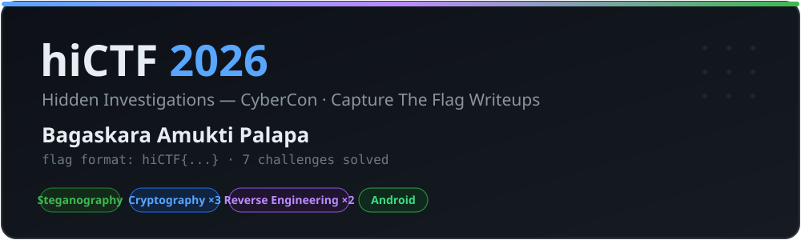

<p align="center">
  
</p>

<p align="center">
  
  
  
  
</p>

# hiCTF 2026 — CTF Writeups

Kumpulan writeup saya untuk **hiCTF 2026** (Hidden Investigations CyberCon / `hicybercon.hiddeninvestigations.net`).
Semua challenge memakai format flag `hiCTF{...}`. Tiap folder berisi writeup lengkap beserta diagram alur solusinya.

## Daftar Writeup

| # | Challenge | Kategori | Poin | Solves | Writeup |
|:-:|---|---|:-:|:-:|:-:|
| 1 | **ChronoGrind** | 🔵 Cryptography | 59 | 312 | [baca »](./ChronoGrind-Cryptography) |
| 2 | **Just Give Me The Flag Man** | 🔵 Cryptography | 60 | 265 | [baca »](./Just-Give-Me-The-Flag-Man-Cryptography) |
| 3 | **Log Jam** | 🔵 Cryptography | — | — | [baca »](./Log-Jam-Cryptography) |
| 4 | **Entitlement** | 🟣 Reverse Engineering | 60 | — | [baca »](./Entitlement-Reverse-Engineering) |
| 5 | **The Inner Engine** | 🟣 Reverse Engineering | 58 | 348 | [baca »](./The-Inner-Engine-Reverse-Engineering) |
| 6 | **Echoes of a Forgotten Canvas** | 🟢 Steganography | 59 | 306 | [baca »](./Echoes-of-a-Forgotten-Canvas-Steganography) |
| 7 | **Cipher** | 🟩 Android | 62 | 234 | [baca »](./Cipher-Android) |

## Ringkasan Teknik

| Challenge | Inti Solusi |
|---|---|
| **ChronoGrind** | Time-lock puzzle RSW — 9 miliar squaring modular berurutan, dipercepat kernel Montgomery AVX-512 IFMA, lalu ChaCha20-Poly1305. |
| **Just Give Me The Flag Man** | Lima lapis encoding: hex ber-Atbash + reverse → ASCII85 → ROT47 → Base91 → Beaufort (kunci `M`). |
| **Log Jam** | Discrete log pada modulus ~71-bit (SageMath), SHA-256 → AES-256 key, dekripsi AES-GCM. |
| **Entitlement** | Unpack UPX tersamar, invers VM di GF(2⁶⁴), Smart's attack pada kurva anomalous, time-lock puzzle disuntik via gdb. |
| **The Inner Engine** | Stack-VM Nim 24 opcode; selesaikan 23 constraint dengan z3, pakai binary sebagai oracle gerbang SHA-256. |
| **Echoes of a Forgotten Canvas** | Empat lapis stego: PNG height trick → ZIP ZipCrypto → steghide → JPEG height trick. |
| **Cipher** | APK vault — ruang seed hanya 2¹⁸, rekonstruksi passphrase (JavaRandom), PBKDF2 root key, dekripsi 64 record AES-256-GCM. |

## Struktur Repo

```
.
├── assets/                                  # banner
├── ChronoGrind-Cryptography/
│   ├── README.md
│   ├── images/
│   └── solver/                              # parse.py, grind_gmp.py, grind_ifma.py, ifma.c, decrypt.py
├── Just-Give-Me-The-Flag-Man-Cryptography/
├── Log-Jam-Cryptography/
├── Entitlement-Reverse-Engineering/
├── The-Inner-Engine-Reverse-Engineering/
├── Echoes-of-a-Forgotten-Canvas-Steganography/
└── Cipher-Android/
```

Tiap folder berisi `README.md` (writeup) + `images/` (diagram alur). ChronoGrind juga menyertakan skrip solver.

---

<p align="center">
  <sub>Ditulis oleh <b>Bagaskara Amukti Palapa</b> · hiCTF 2026</sub>
</p>
