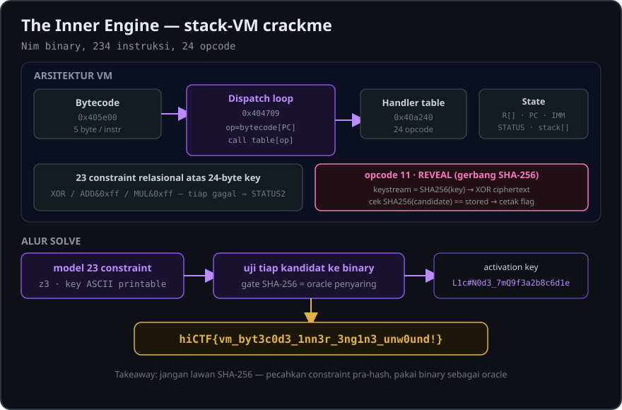

# The Inner Engine — Writeup

- **Kategori:** Reverse Engineering
- **Poin:** 58 (348 solves)
- **Event:** hiCTF — by Hidden Investigations
- **Flag:** `hiCTF{vm_byt3c0d3_1nn3r_3ng1n3_unw0und!}`
- **Activation key:** `L1c#N0d3_7mQ9f3a2b8c6d1e`

<p align="center">
  
</p>

---

## Deskripsi

> Recovered from the LATHE-CAD r4 install media, `\TOOLS\LICENSE\README.1ST`:
> Node-locked activation. Run the checker with your activation key as the only
> argument: `inner-engine <key>`. A valid key unseals the activation record;
> anything else stays sealed.

File: `inner-engine` — Linux x86-64 ELF.
SHA-256: `8c20991917e05093d0c87268ae9563515cd33abc90dd36b916413b5667559f46`

Jalankan dengan key apa pun → selalu `license sealed`:

```
$ ./inner-engine AAAAAAAAAAAAAAAAAAAAAAAA
license sealed
```

---

## 1. Recon

```
$ file inner-engine
ELF 64-bit LSB executable, x86-64, dynamically linked, stripped

$ strings inner-engine
...
syncio.nim        <- ini binary Nim
cmdline.nim / paramStr
@TracerPid:       <- anti-debug
@/proc/self/status
```

Dua string yang tampak ter-obfuscate di `.rodata` (VA `0x406298`):

```
50 55 5f 59 52 4f 59 1c 4f 59 5d 50 59 58 36
```

Di-decode oleh fungsi `0x404691` dengan **XOR 0x3c**:

```python
bytes(c ^ 0x3c for c in b) == b"license sealed\n"
```

Jadi `0x404691` adalah cabang **GAGAL**. Logika asli ada di tempat lain.

---

## 2. Menemukan VM — "The Inner Engine"

Nama soal literal: binary ini berisi **bytecode interpreter**. Dispatch loop
ada di `0x404709`:

```asm
mov   ebx, 0xf4241                 ; gas limit (1000001)
mov   qword [PC], 0                ; PC = 0
.loop:
  cmp   qword [STATUS], 0          ; 0x40aa48 — berhenti jika != 0
  jne   .done
  mov   rdx, [PC]
  cmp   rdx, 0x492                 ; PC max = 0x492 (234 instruksi)
  ja    .halt
  dec   ebx                        ; gas--
  jz    .halt
  ; baca operand 4-byte LE dari bytecode[PC+1..PC+4]
  mov   [IMM], eax                 ; 0x40aa50
  lea   rax, [rdx+5]
  mov   [PC], rax                  ; PC += 5
  movzx eax, byte [rdx + 0x405e00] ; opcode = bytecode[PC]
  mov   rax, [rax*8 + 0x40a240]    ; handler = table[opcode]
  call  rax
  jmp   .loop
```

Karakteristik VM:

| Komponen | Lokasi | Keterangan |
|---|---|---|
| Bytecode | `.rodata` VA `0x405e00` | 1 opcode byte + 4 byte operand LE = **5 byte/instr** |
| Tabel handler | `.bss` `0x40a240` | diisi runtime oleh `0x404588` |
| IMM (operand) | `0x40aa50` | immediate 32-bit |
| PC | `0x40aa58` | offset byte ke bytecode |
| STATUS | `0x40aa48` | 0=jalan, 1=sukses, 2=gagal |
| Register `R[]` | `0x40aa60` | array int32 |
| Input key | `0x40aa78` | string argumen |
| Stack | `0x40aa80` / `0x40aa88` | Nim `seq[int32]` (len/data) |

Helper: `0x403c08` = **PUSH**, `0x403c3f` = **POP**.

---

## 3. Memetakan 24 opcode

Fungsi `0x404588` menulis 24 pointer handler ke slot `table[opcode*8]`. Dengan
menghitung `opcode = (slot - 0x40a240) / 8` dan me-reverse tiap handler kecil:

| Opcode | Mnemonic | Semantik |
|---:|---|---|
| 23  | `PUSH_IMM`   | push(IMM) |
| 76  | `PUSH_IN`    | push(key[IMM]) |
| 149 | `PUSH_REG`   | push(R[IMM]) |
| 56  | `STORE_REG`  | R[IMM] = pop() |
| 163 | `DUP`        | x=pop; push x; push x |
| 110 | `SWAP`       | tukar 2 teratas |
| 43  | `DROP`       | pop() dibuang |
| 125 | `ADD`        | push(a + b) |
| 193 | `SUB`        | push(second − top) |
| 138 | `MUL`        | push(a * b) |
| 82  | `XOR`        | push(a ^ b) |
| 51  | `AND`        | push(a & b) |
| 191 | `OR`         | push(a \| b) |
| 100 | `ROL`        | push(rol(pop, IMM)) |
| 204 | `SHL`        | push(pop << IMM) |
| 113 | `NEG`        | push(−pop) |
| 174 | `NOT`        | push(~pop) |
| 30  | `EQ`         | push(a == b ? 1 : 0) |
| 215 | `JMP`        | PC = IMM |
| 73  | `JZ`         | if pop()==0: PC = IMM |
| 229 | `STATUS1`    | STATUS = 1 (sukses) |
| 90  | `STATUS2`    | STATUS = 2 (gagal) |
| 242 | `NODEBUG`    | push(TracerPid == 0 ? 1 : 0) — anti-debug |
| 11  | `REVEAL`     | dekripsi + cetak flag (lihat §5) |

---

## 4. Program VM & constraint

Decode 234 instruksi (lihat `vm_decoded.txt`). Strukturnya:

```
0:    NODEBUG ; JZ 110          -> gagal kalau ada debugger
      R0=key[0], R1=key[1], R2=key[2], R3=key[3]   ; (ROL8+ROL24 = identitas)
110:  STATUS2                   -> sink GAGAL (semua JZ lompat ke sini)
115:  <23 constraint, tiap gagal -> JZ 110>
1165: REVEAL
1170: STATUS1
```

Constraint pada 24 byte key (semua mod 256, `R0..R3 = key[0..3]`):

```
k5 ^ k6 == 0x54
(k9 +k10)&0xff==0xa4   (k10+k11)&0xff==0xbe   (k12+k13)&0xff==0x9f
(k13+k14)&0xff==0x99   (k14+k15)&0xff==0x94   (k16+k17)&0xff==0x94
(k17+k18)&0xff==0x9a   (k18+k19)&0xff==0x9b   (k19+k20)&0xff==0x99
(k20+k21)&0xff==0x9a   (k22+k23)&0xff==0x96   (k23+k0)&0xff==0xb1
(k3 *k15)&0xff==0x43   (k7 *k21)&0xff==0xec   (k11*k19)&0xff==0x53
k0 ^k8 ^k16==0x21      k4 ^k12^k20==0x41      k2 ^k10^k18==0x36
(k0+k4+k8+k12+k16+k20)&0xff==0x9a
k1 ^k5 ^k9 ^k13^k17^k21==0x56
(k2+k7+k10+k15+k18+k23)&0xff==0x01
k3 ^k6 ^k11^k14^k19^k22==0x77
```

Constraint ini **relasional** (underdetermined) — tidak unik sendiri. Penentu
sebenarnya ada di `REVEAL`.

---

## 5. REVEAL (opcode 11 @ `0x404416`)

Hanya tereksekusi kalau semua 23 constraint lolos. Logikanya:

1. `digest = SHA256(key)` (`0x404004` = SHA-256, konstanta H0..H7 di `.rodata`).
2. Perluas digest → **keystream 40 byte**.
3. `candidate = ciphertext[40] XOR keystream`, dengan ciphertext di `0x4062e0`.
4. Cek `SHA256(candidate) == hash_tersimpan` (`0x4062c0`).
5. Kalau cocok → **cetak `candidate` (flag)**; kalau tidak → diam.

Ini gerbang integritas: karena keystream berasal dari `SHA256(key)` (satu arah),
hanya **key yang benar-benar tepat** yang mendekripsi ciphertext jadi flag valid.
Jadi binary sendiri adalah oracle sempurna.

---

## 6. Solusi

Model 23 constraint VM di **z3** (asumsi key ASCII printable), lalu uji tiap
kandidat ke binary — gate SHA-256 di `REVEAL` otomatis menyaring key palsu.
Kandidat pertama langsung lolos:

```
$ python3 solve.py
FLAG KEY FOUND: 'L1c#N0d3_7mQ9f3a2b8c6d1e'
OUTPUT: hiCTF{vm_byt3c0d3_1nn3r_3ng1n3_unw0und!}
```

Verifikasi:

```
$ ./inner-engine 'L1c#N0d3_7mQ9f3a2b8c6d1e'
hiCTF{vm_byt3c0d3_1nn3r_3ng1n3_unw0und!}

$ ./inner-engine 'L1c#N0d3_7mQ9f3a2b8c6d1X'   # 1 char salah
license sealed
```

## Flag

```
hiCTF{vm_byt3c0d3_1nn3r_3ng1n3_unw0und!}
```

---

## Lampiran A — solve.py

```python
import z3, subprocess, itertools
k=[z3.BitVec('k%d'%i,32) for i in range(24)]
s=z3.Solver()
for b in k:
    s.add(b>=0x20, b<=0x7e)   # printable ASCII assumption
M=lambda x:x&0xff
s.add(M(k[5]^k[6])==0x54)
pairs=[(9,10,0xa4),(10,11,0xbe),(12,13,0x9f),(13,14,0x99),(14,15,0x94),
       (16,17,0x94),(17,18,0x9a),(18,19,0x9b),(19,20,0x99),(20,21,0x9a),
       (22,23,0x96),(23,0,0xb1)]
for a,b,v in pairs: s.add(M(k[a]+k[b])==v)
s.add(M(k[3]*k[15])==0x43)
s.add(M(k[7]*k[21])==0xec)
s.add(M(k[11]*k[19])==0x53)
s.add(M(k[0]^k[8]^k[16])==0x21)
s.add(M(k[4]^k[12]^k[20])==0x41)
s.add(M(k[2]^k[10]^k[18])==0x36)
s.add(M(k[0]+k[4]+k[8]+k[12]+k[16]+k[20])==0x9a)
s.add(M(k[1]^k[5]^k[9]^k[13]^k[17]^k[21])==0x56)
s.add(M(k[2]+k[7]+k[10]+k[15]+k[18]+k[23])==0x01)
s.add(M(k[3]^k[6]^k[11]^k[14]^k[19]^k[22])==0x77)

count=0
while s.check()==z3.sat:
    m=s.model()
    vals=[m[k[i]].as_long() for i in range(24)]
    key=bytes(vals).decode('latin1')
    count+=1
    # test against the binary oracle
    r=subprocess.run(['./inner-engine',key],capture_output=True,text=True)
    out=r.stdout.strip()
    if 'sealed' not in out.lower() and out:
        print("FLAG KEY FOUND:", repr(key))
        print("OUTPUT:", out)
        break
    if count<=20:
        print("cand %d: %r -> %s"%(count,key,out))
    # block this model
    s.add(z3.Or([k[i]!=vals[i] for i in range(24)]))
    if count>=2000:
        print("stopped at 2000 candidates"); break
print("total tested:",count)
```

## Lampiran B — Disassembly bytecode VM (234 instruksi)

```
   0: NODEBUG   0 (0x0)
   5: JZ        110 (0x6e)
  10: PUSH_IN   0 (0x0)
  15: DUP       0 (0x0)
  20: DROP      0 (0x0)
  25: STORE_REG 0 (0x0)
  30: PUSH_IN   1 (0x1)
  35: PUSH_IMM  0 (0x0)
  40: OR        0 (0x0)
  45: STORE_REG 1 (0x1)
  50: PUSH_IN   2 (0x2)
  55: PUSH_IMM  0 (0x0)
  60: SWAP      0 (0x0)
  65: OR        0 (0x0)
  70: STORE_REG 2 (0x2)
  75: PUSH_IN   3 (0x3)
  80: PUSH_IMM  0 (0x0)
  85: SUB       0 (0x0)
  90: ROL       8 (0x8)
  95: ROL       24 (0x18)
 100: STORE_REG 3 (0x3)
 105: JMP       115 (0x73)
 110: STATUS2   0 (0x0)
 115: PUSH_IN   5 (0x5)
 120: PUSH_IN   6 (0x6)
 125: XOR       0 (0x0)
 130: PUSH_IMM  84 (0x54)
 135: EQ        0 (0x0)
 140: JZ        110 (0x6e)
 145: PUSH_IN   9 (0x9)
 150: PUSH_IN   10 (0xa)
 155: ADD       0 (0x0)
 160: PUSH_IMM  255 (0xff)
 165: AND       0 (0x0)
 170: PUSH_IMM  164 (0xa4)
 175: EQ        0 (0x0)
 180: JZ        110 (0x6e)
 185: PUSH_IN   10 (0xa)
 190: PUSH_IN   11 (0xb)
 195: ADD       0 (0x0)
 200: PUSH_IMM  255 (0xff)
 205: AND       0 (0x0)
 210: PUSH_IMM  190 (0xbe)
 215: EQ        0 (0x0)
 220: JZ        110 (0x6e)
 225: PUSH_IN   12 (0xc)
 230: PUSH_IN   13 (0xd)
 235: ADD       0 (0x0)
 240: PUSH_IMM  255 (0xff)
 245: AND       0 (0x0)
 250: PUSH_IMM  159 (0x9f)
 255: EQ        0 (0x0)
 260: JZ        110 (0x6e)
 265: PUSH_IN   13 (0xd)
 270: PUSH_IN   14 (0xe)
 275: ADD       0 (0x0)
 280: PUSH_IMM  255 (0xff)
 285: AND       0 (0x0)
 290: PUSH_IMM  153 (0x99)
 295: EQ        0 (0x0)
 300: JZ        110 (0x6e)
 305: PUSH_IN   14 (0xe)
 310: PUSH_IN   15 (0xf)
 315: ADD       0 (0x0)
 320: PUSH_IMM  255 (0xff)
 325: AND       0 (0x0)
 330: PUSH_IMM  148 (0x94)
 335: EQ        0 (0x0)
 340: JZ        110 (0x6e)
 345: PUSH_IN   16 (0x10)
 350: PUSH_IN   17 (0x11)
 355: ADD       0 (0x0)
 360: PUSH_IMM  255 (0xff)
 365: AND       0 (0x0)
 370: PUSH_IMM  148 (0x94)
 375: EQ        0 (0x0)
 380: JZ        110 (0x6e)
 385: PUSH_IN   17 (0x11)
 390: PUSH_IN   18 (0x12)
 395: ADD       0 (0x0)
 400: PUSH_IMM  255 (0xff)
 405: AND       0 (0x0)
 410: PUSH_IMM  154 (0x9a)
 415: EQ        0 (0x0)
 420: JZ        110 (0x6e)
 425: PUSH_IN   18 (0x12)
 430: PUSH_IN   19 (0x13)
 435: ADD       0 (0x0)
 440: PUSH_IMM  255 (0xff)
 445: AND       0 (0x0)
 450: PUSH_IMM  155 (0x9b)
 455: EQ        0 (0x0)
 460: JZ        110 (0x6e)
 465: PUSH_IN   19 (0x13)
 470: PUSH_IN   20 (0x14)
 475: ADD       0 (0x0)
 480: PUSH_IMM  255 (0xff)
 485: AND       0 (0x0)
 490: PUSH_IMM  153 (0x99)
 495: EQ        0 (0x0)
 500: JZ        110 (0x6e)
 505: PUSH_IN   20 (0x14)
 510: PUSH_IN   21 (0x15)
 515: ADD       0 (0x0)
 520: PUSH_IMM  255 (0xff)
 525: AND       0 (0x0)
 530: PUSH_IMM  154 (0x9a)
 535: EQ        0 (0x0)
 540: JZ        110 (0x6e)
 545: PUSH_IN   22 (0x16)
 550: PUSH_IN   23 (0x17)
 555: ADD       0 (0x0)
 560: PUSH_IMM  255 (0xff)
 565: AND       0 (0x0)
 570: PUSH_IMM  150 (0x96)
 575: EQ        0 (0x0)
 580: JZ        110 (0x6e)
 585: PUSH_IN   23 (0x17)
 590: PUSH_REG  0 (0x0)
 595: ADD       0 (0x0)
 600: PUSH_IMM  255 (0xff)
 605: AND       0 (0x0)
 610: PUSH_IMM  177 (0xb1)
 615: EQ        0 (0x0)
 620: JZ        110 (0x6e)
 625: PUSH_REG  3 (0x3)
 630: PUSH_IN   15 (0xf)
 635: MUL       0 (0x0)
 640: PUSH_IMM  255 (0xff)
 645: AND       0 (0x0)
 650: PUSH_IMM  67 (0x43)
 655: EQ        0 (0x0)
 660: JZ        110 (0x6e)
 665: PUSH_IN   7 (0x7)
 670: PUSH_IN   21 (0x15)
 675: MUL       0 (0x0)
 680: PUSH_IMM  255 (0xff)
 685: AND       0 (0x0)
 690: PUSH_IMM  236 (0xec)
 695: EQ        0 (0x0)
 700: JZ        110 (0x6e)
 705: PUSH_IN   11 (0xb)
 710: PUSH_IN   19 (0x13)
 715: MUL       0 (0x0)
 720: PUSH_IMM  255 (0xff)
 725: AND       0 (0x0)
 730: PUSH_IMM  83 (0x53)
 735: EQ        0 (0x0)
 740: JZ        110 (0x6e)
 745: PUSH_REG  0 (0x0)
 750: PUSH_IN   8 (0x8)
 755: XOR       0 (0x0)
 760: PUSH_IN   16 (0x10)
 765: XOR       0 (0x0)
 770: PUSH_IMM  33 (0x21)
 775: EQ        0 (0x0)
 780: JZ        110 (0x6e)
 785: PUSH_IN   4 (0x4)
 790: PUSH_IN   12 (0xc)
 795: XOR       0 (0x0)
 800: PUSH_IN   20 (0x14)
 805: XOR       0 (0x0)
 810: PUSH_IMM  65 (0x41)
 815: EQ        0 (0x0)
 820: JZ        110 (0x6e)
 825: PUSH_REG  2 (0x2)
 830: PUSH_IN   10 (0xa)
 835: XOR       0 (0x0)
 840: PUSH_IN   18 (0x12)
 845: XOR       0 (0x0)
 850: PUSH_IMM  54 (0x36)
 855: EQ        0 (0x0)
 860: JZ        110 (0x6e)
 865: PUSH_REG  0 (0x0)
 870: PUSH_IN   4 (0x4)
 875: ADD       0 (0x0)
 880: PUSH_IN   8 (0x8)
 885: ADD       0 (0x0)
 890: PUSH_IN   12 (0xc)
 895: ADD       0 (0x0)
 900: PUSH_IN   16 (0x10)
 905: ADD       0 (0x0)
 910: PUSH_IN   20 (0x14)
 915: ADD       0 (0x0)
 920: PUSH_IMM  255 (0xff)
 925: AND       0 (0x0)
 930: PUSH_IMM  154 (0x9a)
 935: EQ        0 (0x0)
 940: JZ        110 (0x6e)
 945: PUSH_REG  1 (0x1)
 950: PUSH_IN   5 (0x5)
 955: XOR       0 (0x0)
 960: PUSH_IN   9 (0x9)
 965: XOR       0 (0x0)
 970: PUSH_IN   13 (0xd)
 975: XOR       0 (0x0)
 980: PUSH_IN   17 (0x11)
 985: XOR       0 (0x0)
 990: PUSH_IN   21 (0x15)
 995: XOR       0 (0x0)
1000: PUSH_IMM  86 (0x56)
1005: EQ        0 (0x0)
1010: JZ        110 (0x6e)
1015: PUSH_REG  2 (0x2)
1020: PUSH_IN   7 (0x7)
1025: ADD       0 (0x0)
1030: PUSH_IN   10 (0xa)
1035: ADD       0 (0x0)
1040: PUSH_IN   15 (0xf)
1045: ADD       0 (0x0)
1050: PUSH_IN   18 (0x12)
1055: ADD       0 (0x0)
1060: PUSH_IN   23 (0x17)
1065: ADD       0 (0x0)
1070: PUSH_IMM  255 (0xff)
1075: AND       0 (0x0)
1080: PUSH_IMM  1 (0x1)
1085: EQ        0 (0x0)
1090: JZ        110 (0x6e)
1095: PUSH_REG  3 (0x3)
1100: PUSH_IN   6 (0x6)
1105: XOR       0 (0x0)
1110: PUSH_IN   11 (0xb)
1115: XOR       0 (0x0)
1120: PUSH_IN   14 (0xe)
1125: XOR       0 (0x0)
1130: PUSH_IN   19 (0x13)
1135: XOR       0 (0x0)
1140: PUSH_IN   22 (0x16)
1145: XOR       0 (0x0)
1150: PUSH_IMM  119 (0x77)
1155: EQ        0 (0x0)
1160: JZ        110 (0x6e)
1165: REVEAL    0 (0x0)
1170: STATUS1   0 (0x0)
```

## Takeaways

- Binary Nim yang di-strip -> cari string `*.nim` untuk identifikasi.
- "Engine/VM" crackme: cari dispatch loop (`call [table + opcode*8]`),
  lebar instruksi tetap, dan tabel handler yang diisi saat runtime.
- Jangan bergulat dengan SHA-256 - kalau checker memakai hash sebagai gerbang
  integritas, pecahkan constraint pra-hash lalu pakai binary sebagai oracle.
